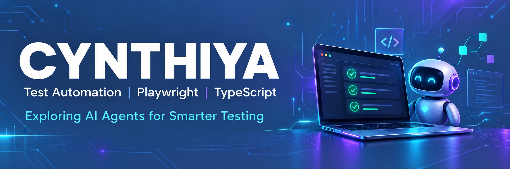

<h1 align="center">Hi 👋, I'm Cynthiya</h1>

  Test Automation | Playwright | TypeScript| JavaScript

---

## 👩‍💻 About Me

- 🤖 Building an AI agent to analyze Playwright test failures and suggest next steps using TypeScript.
- 🔭 Building an OpenCart test automation framework.
- 🧪 Working with Playwright and TypeScript | JavaScript.
- 🌱 Learning AI agents | MCP | LLM
- ⚙️ Interested in reliable automation and CI/CD.

## 🛠️ Tools & Technologies

**Testing:** Playwright | selenium  
**Language:** TypeScript | JavaScript | Java |Python 
**Framework Design:** Page Object Model  
**Reporting:** Allure and Playwright HTML Reports  
**CI/CD:** GitHub Actions  
**Version Control:** Git and GitHub  

## 🚀 Featured Project

### OpenCart Test Automation Framework

Automated tests for the OpenCart web application.

- Page Object Model structure
- HTML and Allure reports
- Screenshots and videos for failed tests
- Automated execution with GitHub Actions

[🔗 Explore the project](https://github.com/cynthiya03/OPenCartPWFramework)

## 🎯 Currently Exploring

Using AI to summarize failed tests, identify possible causes,
and suggest investigation steps.
